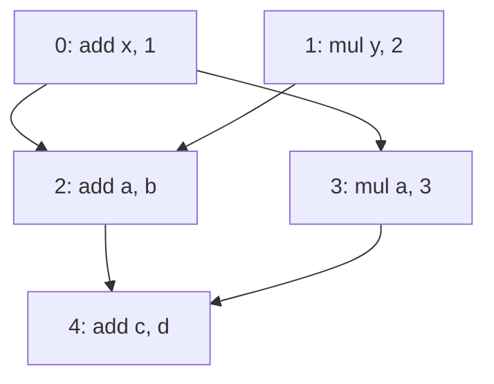

# Mini IR：依赖 DAG 与关键路径分析实验

工程目录：`cpp/03_dependency_dag/`。

当前进度：Lexer、Parser、DefUser 已完成。本轮使用 def-use 结果建立指令依赖图，并计算只受数据依赖限制的理想完成时间。

沿用上一轮已经确认的规则：

- 内部名字允许重复赋值。
- destination 不能与外部输入重名。
- 任何分析错误都会使整次结果无效。

## 1. 实验目标

完成三个功能：

1. 建图：每条指令直接依赖谁，又被谁直接依赖。
2. 计算时间：每条指令最早什么时候开始、什么时候完成。
3. 找出关键路径：输出总延迟最长的一条依赖链。

本轮约定：

- 输入只包含 `add`、`mul`。
- 遇到 `load`、`store`、`ret` 时报告本轮不支持，不静默跳过。
- 只建立 RAW 数据依赖，即消费者等待生产者的结果。
- 常量和外部输入在时间 0 就绪，不单独建立节点。
- 执行资源、发射带宽无限，没有资源竞争。
- 指令延迟表在 DependencyDAG 内部维护：`add` 为 1、`mul` 为 3，使用正整数时间单位；调用方不再传入逐条指令的延迟。
- 保留全部指令，包括无人使用的结果。

本轮不执行运算、不重排指令、不分析 WAR/WAW 或内存依赖。

计算出的时间是该 RAW 模型下的理想完成时间，不是实际 GPU 执行时间，也不表示可以直接按这个时间重排原程序。

## 2. 示例与预期结果

声明 `%x`、`%y` 是外部输入：

```text
%a = add %x, 1
%b = mul %y, 2
%c = add %a, %b
%d = mul %a, 3
%e = add %c, %d
```

指令编号沿用 DefUser 的编号，从 0 开始。空行、注释行不占编号。

如果指令 B 使用了指令 A 的结果，就添加 `A → B`，箭头从生产者指向消费者。



根据内部延迟表，`add` 延迟为 1、`mul` 延迟为 3：

| 指令 | predecessors：我直接等谁 | successors：谁直接等我 | latency | start | finish |
|---:|---|---|---:|---:|---:|
| 0 | 空 | 2、3 | 1 | 0 | 1 |
| 1 | 空 | 2 | 3 | 0 | 3 |
| 2 | 0、1 | 4 | 1 | 3 | 4 |
| 3 | 0 | 4 | 3 | 1 | 4 |
| 4 | 2、3 | 空 | 1 | 4 | 5 |

总完成时间为 5。指令 4 的两个前驱同时完成，按编号选择指令 2，因此输出的关键路径为 `1 → 2 → 4`。

再看一个串行依赖链：

```text
%a = add 1, 2
%b = mul %a, 3
%c = add %b, 4
```

仍使用同一张内部延迟表：

| 指令 | latency | start | finish |
|---:|---:|---:|---:|
| 0 | 1 | 0 | 1 |
| 1 | 3 | 1 | 4 |
| 2 | 1 | 4 | 5 |

关键路径为 `0 → 1 → 2`，总延迟为 `1 + 3 + 1 = 5`。

这些延迟是内部固定的实验假设，不代表真实 GPU 延迟。以后调整延迟时修改内部表，不需要调用方为每条指令提供数值。

## 3. 文件安排

新建目录 `cpp/03_dependency_dag/`，复用上一轮代码，不复制头文件。

| 文件 | 本轮动作 |
|---|---|
| `../02_mini_ir_parser/Lexer.h` | 复用 |
| `../02_mini_ir_parser/Parser.h` | 复用 |
| `../02_mini_ir_parser/DefUser.h` | 复用 |
| `DependencyDAG.h` | 新增数据结构和 DependencyDAG 类 |
| `tests/dependency_dag.cpp` | 新增 Google Test 测试 |
| `CMakeLists.txt` | 新增本目录的独立构建配置 |
| `README.md` | 本实验说明 |

第一版通过测试检查结果即可，不要求增加 `main.cpp` 或命令行输出。

保留上一轮文件和测试。

## 4. 输入准备

上一轮实际返回的类型是：

```cpp
struct DefUseAnalysisResult {
    std::map<size_t, InstructionDefUser> info;
    std::optional<DefUseAnalysisError> error;
};
```

每个 `InstructionDefUser` 已经包含本轮需要的信息：

- `inst`：原始指令，用于检查 opcode。
- `sources`：操作数的来源。
- `sources[j].kind`：Instruction、ExternalInput 或 Constant。
- `sources[j].defining_instruction`：来源为指令时，对应的生产者编号。

沿用当前调用方式：

```cpp
// lexer 已完成输入文本的分词。
Parser parser;
parser.parser_tokenize_line(lexer.results());

DefUser def_user({"%x", "%y"});
def_user.analyze_def_use(parser.results());
```

成功结果的 `info` 键为连续的 `0..N-1`。

本轮 `graph[i]` 必须对应原来的指令 i，不按源码行号重新编号。

建图时直接读取 `sources`：

- 不重新解析字符串。
- 不根据名字重新查找定义。
- 不同时遍历 `sources` 和 `uses` 重复添加边。

## 5. 数据结构与类接口

在 `DependencyDAG.h` 中定义：

```cpp
#pragma once

#include "DefUser.h"

#include <cstdint>
#include <optional>
#include <string>
#include <unordered_map>
#include <vector>

using Cycle = std::uint64_t;

struct DependencyNode {
    std::vector<InstructionId> predecessors;
    std::vector<InstructionId> successors;
};

struct InstructionTiming {
    Cycle start = 0;
    Cycle finish = 0;
    std::optional<InstructionId> critical_predecessor;
};

struct DAGAnalysisInfo {
    std::vector<DependencyNode> graph;
    std::vector<InstructionTiming> timings;
    std::vector<InstructionId> critical_path;
    Cycle total_cycles = 0;
};

struct DAGAnalysisResult {
    std::optional<DAGAnalysisInfo> info;
    std::optional<std::string> error;
};

class DependencyDAG {
public:
    void analyze(const DefUseAnalysisResult& def_use);

    const DAGAnalysisResult& results() const {
        return analysis_result_;
    }

private:
    inline static const std::unordered_map<std::string, Cycle> opcode_latencies_ = {
        {"add", 1},
        {"mul", 3}
    };

    DAGAnalysisResult analysis_result_;
};
```

`analyze()` 的函数体由你实现。

函数体写在类内部时隐式为 inline。如果写在同一个头文件的类外面，需要加 `inline`，并使用 `DependencyDAG::` 限定函数名。

调用示例，对应第 2 节的五条指令：

```cpp
DependencyDAG dag;
dag.analyze(def_user.results());

const auto& result = dag.results();

if (result.error.has_value()) {
    // 报告 *result.error，停止使用本次分析结果。
} else {
    const auto& info = result.info.value();

    // 读取：
    // info.graph
    // info.timings
    // info.critical_path
    // info.total_cycles
}
```

字段约定：

- `graph`、`timings` 长度均为 N，使用同一套指令编号。
- 内部 `opcode_latencies_` 按 opcode 保存延迟；所有 `add` 使用 1，所有 `mul` 使用 3。
- 前驱、后继列表按编号升序保存，不包含重复边。
- `critical_predecessor` 记录使当前指令等待最久的直接前驱；无前驱时为空。
- `critical_path` 按依赖方向保存，从起点到终点。
- `total_cycles` 为所有指令 finish 的最大值，不是全部指令延迟之和。

对象状态约定：

- 刚构造对象、尚未分析时，info 和 error 都为空。
- 每次调用 `analyze()`，先清空旧结果和旧错误。
- 分析成功：info 有值，error 为空。
- 分析失败：info 为空，error 有值。
- 分析失败时清空 info，只保存错误。
- 不返回半成品。
- 同一个对象可以反复调用 `analyze()`。
- 不保存指向输入参数的指针或引用。

`results()` 返回成员的只读引用，下次分析会更新它。如果需要保留旧结果，复制一份：

```cpp
auto saved = dag.results();
```

输入检查：

- 上游 `def_use.error` 非空：报告错误。
- opcode 在内部延迟表中不存在：报告本轮不支持，不静默跳过。

内部延迟表只包含本轮支持的 opcode，表内延迟必须为正整数；调用方没有延迟参数，因此不再检查外部延迟表的长度或数值。

错误文字说明原因即可，不要求逐字固定。

空输入合法：图、时间表、路径均为空，总时间为 0。

本轮接收未被手工修改的 DefUser 成功结果，不要求实现通用图校验器。开发时可用断言检查生产者编号存在且小于消费者编号；测试使用不会溢出的较小延迟。

建图时查找内部延迟表：查不到 opcode 就报告错误；查到则将对应延迟交给时间计算函数。不另行维护一份 opcode 支持列表。

## 6. 第一步：建立依赖图

先创建 N 个节点。即使某条指令完全独立，也必须保留。

按消费者编号从 0 到 N−1 遍历，每条指令的 sources 按以下规则处理：

1. Constant：不加边。
2. ExternalInput：不加边。
3. Instruction：读取 defining_instruction，作为前驱编号。

先收集当前消费者的前驱，再排序、去重。

每个唯一的 `producer → consumer` 对应：

```cpp
graph[consumer].predecessors.push_back(producer);
graph[producer].successors.push_back(consumer);
```

如果已经把去重后的前驱列表写入当前节点，就只需要补充生产者的 successors，不要再次添加 predecessors。

由于消费者按编号递增处理，后继列表自然保持升序。

### 同一个值使用两次

```text
%a = add 1, 2
%b = mul %a, %a
```

DefUser 中是两个操作数使用位置，但图中只有一条 `0 → 1`：

```text
graph[1].predecessors = {0}
graph[0].successors = {1}
```

### 直接依赖与间接依赖

例如已有 `0 → 1 → 2`：

- 不需要因为指令 2 间接依赖指令 0，就自动补一条 `0 → 2`。
- 如果指令 2 也直接读取指令 0 的结果，则必须保留 `0 → 2`。

本轮不额外计算传递闭包。

先测试前驱、后继和边去重，再加入时间计算。

## 7. 第二步：计算开始和完成时间

按指令编号从前向后计算：

```text
无前驱：
    start[i] = 0

有前驱：
    start[i] = max(finish[p])
    p 遍历 i 的直接前驱

latency[i] = 内部延迟表中当前指令 opcode 对应的值
finish[i] = start[i] + latency[i]
```

取最大值，因为当前指令需要等全部输入到齐。

如果两个前驱分别在时间 3、5 完成，当前指令最早在时间 5 开始，不是 8。

时间从 0 开始：

- 指令在时间 0 开始，延迟为 1，则在时间 1 完成。
- 消费者可以在时间 1 开始。
- 不额外加一个周期。

寻找最大 `finish[p]` 时，同时记录对应的 `critical_predecessor`。

如果多个前驱完成时间相同，选择编号最小的前驱，保证结果稳定。

当前 DefUser 只允许读取此前定义，所以每条边都有：

```text
producer < consumer
```

指令编号顺序已经是拓扑顺序，本轮不需要单独实现拓扑排序或环检测。

## 8. 第三步：回溯关键路径

1. 找到 finish 最大的节点，作为终点。
2. 并列时选择编号最小的节点。
3. 把终点加入路径。
4. 沿 critical_predecessor 往前走，逐个加入节点。
5. 遇到没有前驱的节点时停止。
6. 反转路径，得到起点到终点的顺序。
7. 最大 finish 就是 total_cycles。

空图直接返回空路径和 0，不查找终点。

用第 2 节示例验证，均使用内部固定延迟表：

| 示例 | critical_path | total_cycles |
|---|---|---:|
| 五条指令 | `{1,2,4}` | 5 |
| 三条指令的串行依赖链 | `{0,1,2}` | 5 |

额外检查：

- 路径中相邻节点之间确实有边。
- 路径上各节点的延迟之和等于 total_cycles。

## 9. 必须正确处理的情况

### 内部重复赋值

```text
%a = add 1, 2
%a = mul %a, %a
%b = add %a, 3
```

应得到：

```text
0 → 1 → 2
```

不能因为前两条都写 `%a`，就把它们合成同一个节点。

指令 1 读取指令 0 产生的值；指令 2 读取指令 1 产生的值。这些来源已经由 DefUser 确定，直接使用来源编号即可。

### 同名定义不一定有 RAW 依赖

```text
%a = add 1, 2
%a = mul 3, 4
```

第二条没有读取第一条的结果，因此本轮不添加 `0 → 1`。

它们存在 WAW 关系，但本轮不建立 WAW。这也是当前图不能直接用于指令重排的原因。

### 独立节点不能丢失

```text
%a = add 1, 2
%b = mul 3, 4
```

图中有两个节点，没有边。

根据内部表，`add` 延迟为 1、`mul` 延迟为 3：

- 两条指令都在时间 0 开始。
- 总时间为 3。
- 关键路径只有节点 1。

### 上游错误不能当作空程序

DefUser 出错时，可能同时表现为：

```text
info 为空
error 有值
```

这与合法空程序不同，必须先检查 error。

### 同一个对象重复调用

分别执行：

1. 分析成功。
2. 分析失败。
3. 分析空程序。

最终应得到成功的空结果，总时间为 0，不能残留第一次的图或第二次的错误。

## 10. 验收测试

测试直接检查数据结构，不只观察打印结果。

可复用上一轮 `tests/defuser.cpp` 中的 `parse_program` 写法，让测试经过：

```text
Lexer → Parser → DefUser → DependencyDAG
```

| 测试组 | 检查内容 |
|---|---|
| 正常建图 | 第 2 节五条指令的全部前驱、后继正确 |
| 内部延迟表 | add 为 1、mul 为 3；五条指令的 start 为 `{0,0,3,1,4}`、finish 为 `{1,3,4,4,5}`，路径 `{1,2,4}`，总时间为 5 |
| 串行依赖链 | add → mul → add；start 为 `{0,1,4}`，finish 为 `{1,4,5}`，路径 `{0,1,2}` |
| 前驱时间并列 | 五条指令示例中，指令 4 选择编号较小的前驱 2 |
| 终点时间并列 | 两条独立 mul 同时完成时，选择编号较小的节点 0 |
| 重复操作数 | 同一生产者被两个操作数读取时，前驱和后继均不重复 |
| 内部重复赋值 | 同名定义使用不同节点，来源指向正确的定义 |
| 空行和注释 | 不影响节点数、编号、边和时间 |
| 独立节点 | 无边，start 均为 0，总时间为最大延迟 |
| 空输入 | 成功，图、时间表、路径为空，总时间为 0 |
| 单节点 | 单条 add 的 finish 为 1，单条 mul 的 finish 为 3；start 均为 0、路径均为 `{0}` |
| 上游失败 | error 有值、info 为空，不能返回成功的空图 |
| 不支持的 opcode | load、store、ret 分别报错，不静默跳过 |
| 重复调用 | 同一对象成功、失败、再次成功时，状态均正确 |

建议先完成“正常建图”和“重复操作数”，再逐步补充其他测试。

## 11. 编译与运行

在 `cpp/03_dependency_dag/` 创建独立的 `CMakeLists.txt`：

```cmake
cmake_minimum_required(VERSION 3.14)
project(dependency_dag CXX)

set(CMAKE_CXX_STANDARD 20)
set(CMAKE_CXX_STANDARD_REQUIRED ON)
set(CMAKE_EXPORT_COMPILE_COMMANDS ON)

if(NOT CMAKE_BUILD_TYPE)
  set(CMAKE_BUILD_TYPE Debug)
endif()

add_compile_options(-Wall -Wextra -Wpedantic)

option(ENABLE_SANITIZERS "Enable ASan and UBSan" ON)
if(ENABLE_SANITIZERS AND CMAKE_BUILD_TYPE STREQUAL "Debug")
  add_compile_options(-fsanitize=address,undefined -fno-omit-frame-pointer)
  add_link_options(-fsanitize=address,undefined)
endif()

list(APPEND CMAKE_PREFIX_PATH "$ENV{HOME}/.local")
find_package(GTest REQUIRED)

enable_testing()
include(GoogleTest)

add_executable(dependency_dag_test tests/dependency_dag.cpp)

target_include_directories(dependency_dag_test PRIVATE
  ${CMAKE_CURRENT_SOURCE_DIR}
  ${CMAKE_CURRENT_SOURCE_DIR}/../02_mini_ir_parser
)

target_link_libraries(dependency_dag_test PRIVATE GTest::gtest_main)

gtest_discover_tests(dependency_dag_test)
```

配置包含了上一轮的头文件目录，因此本轮可以直接写：

```cpp
#include "DefUser.h"
```

在仓库根目录执行：

```bash
cmake -S cpp/03_dependency_dag -B cpp/03_dependency_dag/build -DCMAKE_BUILD_TYPE=Debug
cmake --build cpp/03_dependency_dag/build -j
ctest --test-dir cpp/03_dependency_dag/build --output-on-failure
```

如果测试套件命名为 `DependencyDAGTest`：

```bash
ctest --test-dir cpp/03_dependency_dag/build -R DependencyDAGTest --output-on-failure
```

沿用上一轮 C++20、Google Test 和 ASan/UBSan 配置。

## 12. 本轮练习的 C++ 标准库

| 工具 | 用途 |
|---|---|
| `std::vector` | 保存图节点、时间和路径 |
| `std::map::at` | 读取已存在的 DefUser 条目，避免查询时插入 |
| `std::unordered_map::find` | 查询内部 opcode 延迟表，并判断指令是否受支持 |
| `std::sort` | 对前驱编号排序 |
| `std::unique` + `vector::erase` | 删除排序后的重复前驱 |
| `std::optional` | 表示有没有结果、错误或关键前驱 |
| `std::reverse` | 反转回溯得到的路径 |

注意：

- `std::unique` 不会缩小 vector，它返回新的逻辑末尾。
- 需要配合 `erase` 删除尾部。
- `sort`、`unique`、`reverse` 需要包含 `<algorithm>`。
- 使用 `assert` 时包含 `<cassert>`。

## 13. 完成标准

- 使用 DependencyDAG 类封装分析和结果。
- 直接复用 DefUser 的来源编号建立图。
- 正确建立前驱、后继列表并去重。
- 内部重复赋值能区分每次定义。
- 正确计算 start、finish 和总完成时间。
- 指令延迟由内部 opcode 表提供，调用方只传入 DefUser 结果。
- 输出一条方向正确、延迟正确的关键路径。
- 空输入、独立节点和错误输入按约定处理。
- 同一个对象可以重复分析，不残留旧状态。
- 测试通过，提交后进行 Review。

实现顺序：先建图并测试，再计算时间，最后回溯关键路径。
